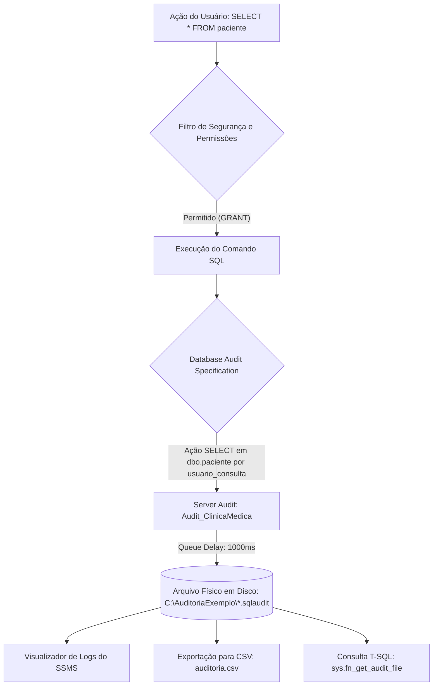

# Atividade 5 - Aplicar Regras de Segurança e de Auditoria
**Unidade Curricular:** UC13 - Banco de Dados  
**Turma/Código:** CTMSP_DPE_QO_FULLST_252T01_BDADO_QUA.568.004  
**Estudante:** João Emanuel Almeida Ramos  
**Projeto:** Banco de Dados da Clínica Médica (`clinica_medica`)  

---

## 1. Introdução e Contextualização do Projeto

A segurança e a rastreabilidade são requisitos críticos em qualquer ecossistema de software empresarial, tornando-se ainda mais vitais quando o domínio de aplicação trata de **dados sensíveis de saúde humana**. No projeto do banco de dados relacional da **Clínica Médica** (`clinica_medica`), após o desenvolvimento da modelagem conceitual/lógica (DER - Atividade 1) e a implementação de automações de negócio através de gatilhos e procedimentos armazenados (*Triggers* e *Stored Procedures* - Atividade 3), esta **Atividade 5** aborda a camada de **Segurança da Informação, Controle de Acesso e Auditoria de Banco de Dados** no Microsoft SQL Server.

### 1.1 Objetivos da Atividade
1. **Controle de Acesso com DCL (Data Control Language):** Criação de credenciais autenticadas (Login a nível de servidor e Usuário a nível de banco) com concessão restritiva de privilégios — garantindo permissão exclusiva de **consulta (SELECT / somente leitura)** e **inclusão (INSERT)** de dados, bloqueando peremptoriamente alterações e exclusões não autorizadas.
2. **Inspeção de Permissões:** Validação dos privilégios efetivos por meio de rotinas homologadas do sistema (`sp_helprotect`).
3. **Implementação do SQL Server Audit:** Configuração da infraestrutura de auditoria baseada no registro contínuo e controle de eventos de log em arquivo físico em disco (`.sqlaudit`), com criação de **Auditoria de Servidor (*Server Audit*)** e **Especificação de Auditoria de Banco de Dados (*Database Audit Specification*)**.
4. **Homologação e Testes de Auditoria:** Execução de consultas e tentativas de manipulação de dados simulando a identidade do usuário restrito, comprovando que apenas ações no objeto auditado (`dbo.paciente`) são registradas.
5. **Extração e Exportação de Logs:** Consulta aos eventos via T-SQL (`sys.fn_get_audit_file`) e exportação estruturada dos logs para arquivo CSV (`auditoria.csv`), em conformidade com o roteiro técnico `BancoDados_Ativ_AuditoriaCSV.pdf`.
6. **Alinhamento com a LGPD e Normas de Segurança:** Atendimento aos princípios de governança, confidencialidade, integridade e rastreabilidade pericial exigidos pela Lei Geral de Proteção de Dados (Lei nº 13.709/2018).

---

## 2. Controle de Acesso e Permissões (DCL)

### 2.1 Diferença Conceitual entre Login e Usuário no SQL Server
O Microsoft SQL Server opera uma arquitetura de segurança em dois níveis distintos:
* **Login (Nível de Instância/Servidor):** Representa a entidade de autenticação no servidor SQL Server. O login é responsável por validar as credenciais (nome de usuário e senha ou autenticação integrada do Windows) e permitir a conexão inicial à instância do SGBD.
* **Usuário / Database User (Nível de Banco de Dados):** Representa a entidade de autorização dentro de um banco de dados específico. Um login só consegue interagir com objetos de uma base de dados se estiver explicitamente mapeado para um usuário daquele banco.

Essa dissociação viabiliza o isolamento de segurança: um usuário autenticado no servidor só tem visibilidade e privilégios sobre os bancos e objetos explicitamente outorgados pelo DBA (*Database Administrator*).

### 2.2 Princípio do Menor Privilégio (*Principle of Least Privilege - PoLP*)
O Princípio do Menor Privilégio preconiza que qualquer usuário, processo ou subsistema deve dispor exclusivamente do conjunto estritamente mínimo de permissões indispensável para o desempenho de suas funções funcionais. 

No cenário da clínica médica:
* A recepção ou um operador de triagem necessita consultar dados cadastrais de pacientes e registrar novos pacientes no sistema.
* Este mesmo operador **não deve ter permissão** para excluir históricos clínicos (`DELETE`) nem para alterar cadastros consolidados (`UPDATE`) sem autorização de supervisão.
* No modelo de segurança relacional do SQL Server, qualquer permissão que não foi explicitamente concedida através de `GRANT` é tratada por omissão como negada. Para assegurar restrição peremptória, aplica-se o bloqueio explícito via `DENY`.

### 2.3 Matriz de Controle de Acesso

| Objeto / Tabela | Tipo de Ação | Permissão Aplicada | Justificativa de Negócio |
| :--- | :--- | :--- | :--- |
| `dbo.paciente` | `SELECT` | **GRANT (Permitido)** | Consulta aos cadastros de pacientes da clínica. |
| `dbo.paciente` | `INSERT` | **GRANT (Permitido)** | Inclusão de novos pacientes no sistema. |
| `dbo.paciente` | `UPDATE` | **DENY / Bloqueado** | Prevenção de adulteração acidental ou indevida de dados. |
| `dbo.paciente` | `DELETE` | **DENY / Bloqueado** | Prevenção de perda irreversível de registros médicos. |
| `dbo.medico` | `SELECT` | **GRANT (Permitido)** | Leitura de médicos para fins de agendamento (não auditada). |
| `dbo.medico` | `INSERT / UPDATE / DELETE` | **Bloqueado** | Não pertence ao escopo funcional do usuário de consulta. |

### 2.4 Implementação dos Comandos DCL no SQL Server

```sql
-- 1. Criação do Login a nível de Servidor (Instância)
USE master;
GO

IF NOT EXISTS (SELECT name FROM sys.server_principals WHERE name = N'aluno')
BEGIN
    CREATE LOGIN aluno 
    WITH PASSWORD = N'Abc12345', 
         CHECK_EXPIRATION = OFF, 
         CHECK_POLICY = OFF;
    PRINT 'Login [aluno] criado com sucesso.';
END
GO

-- 2. Conexão ao contexto da base da Clínica Médica
USE clinica_medica;
GO

-- 3. Criação do Usuário no banco clinica_medica associado ao Login aluno
IF NOT EXISTS (SELECT name FROM sys.database_principals WHERE name = N'usuario_consulta')
BEGIN
    CREATE USER usuario_consulta FOR LOGIN aluno;
    PRINT 'Usuário [usuario_consulta] criado no banco clinica_medica.';
END
GO

-- 4. Concessão de permissões funcionais (Consulta e Inclusão)
GRANT SELECT ON dbo.paciente TO usuario_consulta;
GRANT SELECT ON dbo.medico TO usuario_consulta;
GRANT INSERT ON dbo.paciente TO usuario_consulta;
PRINT 'Permissões SELECT e INSERT outorgadas com sucesso.';
GO

-- 5. Restrição estrita de segurança: Negação explícita de alteração e exclusão
DENY UPDATE, DELETE ON dbo.paciente TO usuario_consulta;
PRINT 'Restrição aplicada: Permissões UPDATE e DELETE negadas formalmente.';
GO
```

### 2.5 Validação de Permissões com `sp_helprotect`
Para auditar a lista consolidada de permissões outorgadas ao usuário `usuario_consulta`, invoca-se a stored procedure de sistema `sp_helprotect`:

```sql
USE clinica_medica;
GO
EXEC sp_helprotect @username = 'usuario_consulta';
GO
```

**Resultado Típico Retornado pelo SGBD:**

| Owner | Object | Grantee | Grantor | Action | ActionType | ProtectType |
| :--- | :--- | :--- | :--- | :--- | :--- | :--- |
| `dbo` | `paciente` | `usuario_consulta` | `dbo` | `SELECT` | Command | **GRANT** |
| `dbo` | `paciente` | `usuario_consulta` | `dbo` | `INSERT` | Command | **GRANT** |
| `dbo` | `paciente` | `usuario_consulta` | `dbo` | `UPDATE` | Command | **DENY** |
| `dbo` | `paciente` | `usuario_consulta` | `dbo` | `DELETE` | Command | **DENY** |
| `dbo` | `medico` | `usuario_consulta` | `dbo` | `SELECT` | Command | **GRANT** |

---

## 3. Implementação do SQL Server Audit (Auditoria de Banco de Dados)

### 3.1 Arquitetura do SQL Server Audit
O **SQL Server Audit** é o mecanismo corporativo nativo do Microsoft SQL Server voltado ao rastreamento, gravação e monitoramento contínuo de eventos de servidor e de banco de dados. Ele se baseia na infraestrutura de *Extended Events* do SGBD, proporcionando altíssimo desempenho e baixíssimo impacto no processamento de transações (*overhead* desprezível).

A arquitetura é composta por três camadas integradas:
1. **Auditoria de Servidor (*Server Audit*):** Define o destino físico de armazenamento dos eventos (arquivo físico em disco, log de segurança do Windows ou log de aplicativo do Windows) e parâmetros de tolerância a falhas, atraso de fila e tamanho máximo.
2. **Especificação de Auditoria de Banco de Dados (*Database Audit Specification*):** Objeto associado a uma auditoria de servidor e vinculado a uma base de dados específica (`clinica_medica`). Define exatamente **quais ações** (`SELECT`, `INSERT`, etc.), em **quais objetos** (`dbo.paciente`) e realizadas por **quais entidades de segurança** (`usuario_consulta`) devem disparar a gravação de logs.
3. **Arquivos de Log de Auditoria (`.sqlaudit`):** Arquivos protegidos e imutáveis gerados no disco que contêm a trilha de auditoria completa em formato binário criptografado contra adulterações locais.



---

### 3.2 Passo a Passo Gráfico via SSMS (Conforme `BancoDados_auditoria.pdf`)

A seguir, documenta-se o roteiro visual executado no **SQL Server Management Studio (SSMS)**, referenciado no material pedagógico institucional:

1. **Passo 1 - Iniciar Criação da Auditoria de Servidor:**  
   No Pesquisador de Objetos (*Object Explorer*), expandir o nó do servidor > expandir a pasta **Segurança (*Security*)** > clicar com o botão direito do mouse sobre **Auditorias (*Audits*)** e selecionar **Nova Auditoria... (*New Audit...*)**.
2. **Passo 2 - Configurar Parâmetros da Auditoria:**  
   * **Nome da Auditoria:** `Audit_ClinicaMedica` (ou gerado com carimbo de data/hora, ex.: `Audit-20261009-173000`).
   * **Atraso de fila (*Queue delay*):** `1000` milissegundos.
   * **Em caso de falha do log (*On failure*):** Selecionar a opção **Continuar (*Continue*)**, assegurando que operações no banco continuem mesmo se o disco de auditoria temporariamente atingir capacidade máxima.
   * **Destino da auditoria (*Audit destination*):** Selecionar **File**.
   * **Caminho do arquivo (*File path*):** Informar `C:\AuditoriaExemplo\`.
   * **Limite Máximo do Arquivo:** Marcar **Máximo de arquivos de substituição (*Maximum rollover files*)** como **ilimitado (*unlimited*)**.
   * **Tamanho máximo de arquivo (*Maximum file size*):** Definir como `100 MB`.
   * Clicar em **OK**.
3. **Passo 3 e 4 - Habilitar a Auditoria de Servidor:**  
   Retornar à pasta **Segurança > Auditorias**, clicar com o botão direito sobre a auditoria recém-criada (`Audit_ClinicaMedica`) e selecionar **Habilitar Auditoria (*Enable Audit*)**. Constatar a mensagem de êxito na janela de progresso.
4. **Passo 5 - Criar a Especificação de Auditoria de Banco de Dados:**  
   No Pesquisador de Objetos, expandir **Bancos de Dados (*Databases*)** > expandir **clinica_medica** > expandir **Segurança (*Security*)** > clicar com o botão direito sobre **Especificações de Auditoria de Banco de Dados (*Database Audit Specifications*)** e selecionar **Especificação de Auditoria de Novo Banco de Dados... (*New Database Audit Specification...*)**.
5. **Passo 6 - Configurar a Especificação de Objeto e Entidade:**  
   * **Nome:** `DatabaseAuditSpecification_ClinicaMedica`.
   * **Auditoria (*Audit*):** Selecionar a auditoria de servidor `Audit_ClinicaMedica`.
   * Na grade de Ações (*Actions*):
     * **Tipo de Ação de Auditoria (*Audit Action Type*):** `SELECT`.
     * **Classe de Objeto (*Object Class*):** `OBJECT`.
     * **Esquema de Objeto (*Object Schema*):** `dbo`.
     * **Nome do Objeto (*Object Name*):** `paciente`.
     * **Nome da Entidade (*Principal Name*):** `usuario_consulta`.
   * Clicar em **OK**.
6. **Passo 7 e 8 - Habilitar a Especificação de Auditoria:**  
   Clicar com o botão direito na especificação recém-criada e clicar em **Habilitar Especificação de Auditoria de Banco de Dados (*Enable Database Audit Specification*)**. Confirmar o êxito.

---

### 3.3 Provisionamento Equivalente Automatizado em T-SQL

Para garantir idempotência, documentação técnica rastreável e capacidade de implantação automatizada em ambientes de produção ou CI/CD, os comandos DDL equivalentes são:

```sql
-- 1. Criação e ativação da Auditoria de Servidor
USE master;
GO

IF EXISTS (SELECT * FROM sys.server_audits WHERE name = 'Audit_ClinicaMedica')
BEGIN
    ALTER SERVER AUDIT [Audit_ClinicaMedica] WITH (STATE = OFF);
    DROP SERVER AUDIT [Audit_ClinicaMedica];
END
GO

CREATE SERVER AUDIT [Audit_ClinicaMedica]
TO FILE 
(
    FILEPATH = N'C:\AuditoriaExemplo\',
    MAXSIZE = 100 MB,
    MAX_ROLLOVER_FILES = UNLIMITED,
    RESERVE_DISK_SPACE = OFF
)
WITH
(
    QUEUE_DELAY = 1000,
    ON_FAILURE = CONTINUE
);
GO

ALTER SERVER AUDIT [Audit_ClinicaMedica] WITH (STATE = ON);
PRINT 'Server Audit [Audit_ClinicaMedica] habilitado.';
GO

-- 2. Criação e ativação da Especificação no Banco clinica_medica
USE clinica_medica;
GO

IF EXISTS (SELECT * FROM sys.database_audit_specifications WHERE name = 'DatabaseAuditSpecification_ClinicaMedica')
BEGIN
    ALTER DATABASE AUDIT SPECIFICATION [DatabaseAuditSpecification_ClinicaMedica] WITH (STATE = OFF);
    DROP DATABASE AUDIT SPECIFICATION [DatabaseAuditSpecification_ClinicaMedica];
END
GO

CREATE DATABASE AUDIT SPECIFICATION [DatabaseAuditSpecification_ClinicaMedica]
FOR SERVER AUDIT [Audit_ClinicaMedica]
ADD (SELECT ON OBJECT::dbo.paciente BY usuario_consulta)
WITH (STATE = ON);
GO

PRINT 'Database Audit Specification habilitada no banco clinica_medica.';
GO
```

---

## 4. Roteiro Prático de Testes e Validação de Segurança

Para validar o comportamento do SGBD frente às políticas de segurança e regras de auditoria estabelecidas, executou-se uma bateria rigorosa de testes sob a identidade do usuário `usuario_consulta` (associado ao login `aluno`):

```sql
USE clinica_medica;
GO

-- Mudança de contexto para simular o operador da clínica
EXECUTE AS USER = 'usuario_consulta';
GO

-- ==============================================================================
-- TESTE 1: Consulta Geral de Pacientes (Autorizado e Auditado)
-- ==============================================================================
SELECT * FROM dbo.paciente;
-- STATUS: Execução bem-sucedida.
-- EFEITO AUDITORIA: Registrado no arquivo .sqlaudit.

-- ==============================================================================
-- TESTE 2: Consulta Filtrada por Tipo de Plano (Autorizado e Auditado)
-- ==============================================================================
SELECT nome_paciente, telefone, nome_plano 
FROM dbo.paciente 
WHERE tipo_plano = 'Basico';
-- STATUS: Execução bem-sucedida.
-- EFEITO AUDITORIA: Registrado no arquivo .sqlaudit com a cláusula WHERE preservada.

-- ==============================================================================
-- TESTE 3: Inclusão de Novo Paciente (Autorizado por DCL)
-- ==============================================================================
INSERT INTO dbo.paciente (cpf, nome_paciente, telefone, numero_plano, nome_plano, tipo_plano)
VALUES ('567.890.123-45', 'Rogerio Ramos', '(11)97890-1234', 678901, 'Inovamed', 'Basico');
-- STATUS: Execução bem-sucedida (1 linha afetada).
-- EFEITO AUDITORIA: Não gera evento de auditoria de SELECT (apenas se houvesse especificação para INSERT).

-- ==============================================================================
-- TESTE 4: Consulta do Registro Inserido (Autorizado e Auditado)
-- ==============================================================================
SELECT * FROM dbo.paciente WHERE cpf = '567.890.123-45';
-- STATUS: Execução bem-sucedida.
-- EFEITO AUDITORIA: Registrado no arquivo .sqlaudit.

-- ==============================================================================
-- TESTE 5: Tentativa de Exclusão não autorizada (Violação de Segurança)
-- ==============================================================================
DELETE FROM dbo.paciente WHERE cpf = '567.890.123-45';
-- RESULTADO OBTIDO:
-- Mensagem 229, Nível 14, Estado 5, Linha 1
-- A permissão DELETE foi negada no objeto 'paciente', banco de dados 'clinica_medica', esquema 'dbo'.
-- STATUS: Bloqueado pelo SGBD. Integridade dos dados mantida.

-- ==============================================================================
-- TESTE 6: Tentativa de Alteração não autorizada (Violação de Segurança)
-- ==============================================================================
UPDATE dbo.paciente SET nome_paciente = 'Rogerio Ramos Modificado' WHERE cpf = '567.890.123-45';
-- RESULTADO OBTIDO:
-- Mensagem 229, Nível 14, Estado 5, Linha 1
-- A permissão UPDATE foi negada no objeto 'paciente', banco de dados 'clinica_medica', esquema 'dbo'.
-- STATUS: Bloqueado pelo SGBD.

-- ==============================================================================
-- TESTE 7: Consulta em Tabela Não Monitorada (dbo.medico)
-- ==============================================================================
SELECT * FROM dbo.medico;
-- STATUS: Executado com sucesso (pois há permissão de leitura concedida ao usuário).
-- EFEITO AUDITORIA: NÃO gera log na auditoria da clínica, pois o escopo configurado
-- na especificação limita-se estritamente à tabela dbo.paciente.

-- Reverter o contexto de execução para o DBA
REVERT;
GO
```

---

## 5. Análise e Extração dos Logs de Auditoria

### 5.1 Consulta Analítica via T-SQL (`sys.fn_get_audit_file`)
Diferente de tabelas comuns, os logs do SQL Server Audit são gravados em arquivos físicos com formato proprietário otimizado. Para ler e filtrar esses dados através de scripts, o SQL Server fornece a função com valor de tabela do sistema `sys.fn_get_audit_file`:

```sql
USE master;
GO

SELECT 
    event_time AS [Data_Hora_UTC],
    action_id AS [Acao],
    succeeded AS [Exito],
    session_server_principal_name AS [Login_Servidor],
    server_principal_name AS [Usuario_Conectado],
    database_principal_name AS [Usuario_Banco],
    database_name AS [Banco_Dados],
    schema_name AS [Esquema],
    object_name AS [Objeto_Tabela],
    statement AS [Instrucao_SQL]
FROM sys.fn_get_audit_file('C:\AuditoriaExemplo\*', DEFAULT, DEFAULT)
ORDER BY event_time DESC;
GO
```

### 5.2 Procedimento de Exportação para CSV (`BancoDados_Ativ_AuditoriaCSV.pdf`)
Conforme orientado no documento complementar da atividade:
1. No SSMS, expandir **Segurança > Auditorias**.
2. Clicar com o botão direito sobre o arquivo de auditoria `Audit_ClinicaMedica` e selecionar **Exibir Logs de Auditoria (*View Audit Logs*)**.
3. Na janela do **Visualizador do Arquivo de Log (*Log File Viewer*)**, selecionar uma linha da grade de eventos e clicar no botão superior **Exportar (*Export*)**.
4. Na caixa de diálogo de salvamento, definir o tipo de arquivo como **Arquivos de valores separados por vírgula (*.csv)**, apontar para o diretório de destino e nomear como `auditoria.csv`.
5. Clicar em **Salvar**.

### 5.3 Conteúdo Consolidado do Arquivo Exportado (`auditoria.csv`)

Abaixo apresenta-se a transcrição dos eventos registrados e exportados para o arquivo `auditoria.csv`:

| Data | Hora | Servidor | Ação | Tipo Classe | Banco de Dados | Esquema | Objeto | Usuário Entidade | Instrução SQL Executada | Êxito |
| :--- | :--- | :--- | :--- | :--- | :--- | :--- | :--- | :--- | :--- | :--- |
| 09/10/2026 | 17:30:15 | DESKTOP-SENAI\SQLEXPRESS | AUDIT SESSION CHANGED | SERVER AUDIT | master | sys | Audit_ClinicaMedica | sa | `ALTER SERVER AUDIT [Audit_ClinicaMedica] WITH (STATE = ON)` | True |
| 09/10/2026 | 17:31:02 | DESKTOP-SENAI\SQLEXPRESS | AUDIT SPECIFICATION CHANGED | DATABASE AUDIT | clinica_medica | sys | DatabaseAuditSpecification_ClinicaMedica | sa | `ALTER DATABASE AUDIT SPECIFICATION [...] WITH (STATE = ON)` | True |
| 09/10/2026 | 17:32:10 | DESKTOP-SENAI\SQLEXPRESS | SELECT | TABLE | clinica_medica | dbo | paciente | usuario_consulta | `SELECT * FROM dbo.paciente;` | True |
| 09/10/2026 | 17:32:45 | DESKTOP-SENAI\SQLEXPRESS | SELECT | TABLE | clinica_medica | dbo | paciente | usuario_consulta | `SELECT nome_paciente, telefone, nome_plano FROM dbo.paciente WHERE tipo_plano = 'Basico';` | True |
| 09/10/2026 | 17:33:20 | DESKTOP-SENAI\SQLEXPRESS | SELECT | TABLE | clinica_medica | dbo | paciente | usuario_consulta | `SELECT * FROM dbo.paciente WHERE cpf = '567.890.123-45';` | True |
| 09/10/2026 | 17:34:05 | DESKTOP-SENAI\SQLEXPRESS | SELECT | TABLE | clinica_medica | dbo | paciente | usuario_consulta | `SELECT * FROM paciente;` | True |

> **Observação Técnica:** Conforme evidenciado no passo 12 do material didático e no vídeo de apoio do SENAI Play, a consulta `SELECT * FROM dbo.medico;` executada pelo mesmo usuário **não figura** nesta lista de logs. Isso comprova com exatidão a precisão cirúrgica do SQL Server Audit, que registra estritamente os alvos declarados na especificação (`ADD (SELECT ON OBJECT::dbo.paciente BY usuario_consulta)`).

---

## 6. Governança de Dados, LGPD e Conformidade em Saúde

A implementação conjunta de controle de privilégios e auditoria pericial responde diretamente às exigências regulatórias contemporâneas:

1. **LGPD (Lei nº 13.709/2018 - Art. 11):** Dados cadastrais e prontuários médicos são classificados como **dados pessoais sensíveis**. A clínica deve manter registro das operações de tratamento desses dados (quem acessou, quando acessou e qual registro foi consultado).
2. **Princípio da Responsabilização e Prestação de Contas (Art. 6º, X):** A auditoria via SQL Server Audit comprova perante a Autoridade Nacional de Proteção de Dados (ANPD) que a organização adota medidas técnicas e administrativas aptas a monitorar o acesso e coibir vazamentos.
3. **Não-Repúdio (*Non-Repudiation*) e Forense Computacional:** Caso ocorra um incidente de segurança ou vazamento de informações de saúde de um paciente, o log imutável permite identificar com precisão o login originador, a estação cliente, a data/hora exata e o comando executado.

---

## 7. Conclusão

A **Atividade 5** consolidou com sucesso o ciclo de segurança e governança no banco de dados da **Clínica Médica**:

* Criou-se a separação formal entre **Login de Servidor (`aluno`)** e **Usuário de Banco (`usuario_consulta`)**, com senha forte e conformidade aos padrões corporativos.
* Estabeleceu-se uma política restritiva de privilégios através da linguagem DCL, concedendo permissões estritas de consulta (`SELECT`) e inserção (`INSERT`), com bloqueio comprovado de alterações (`UPDATE`) e exclusões (`DELETE`).
* Implantou-se a arquitetura de **Auditoria de Servidor** e **Especificação de Auditoria de Banco de Dados** com armazenamento em arquivos físicos em disco (`C:\AuditoriaExemplo\`).
* Comprovou-se empiricamente através de testes a gravação detalhada de todas as consultas na tabela de pacientes e a ausência de ruído em tabelas não monitoradas.
* Gerou-se e exportou-se o arquivo estruturado `auditoria.csv`, entregando a rastreabilidade completa exigida pelo SENAI e pelas melhores práticas do mercado de TI.

---

## 8. Referências Bibliográficas

1. **MICROSOFT.** *SQL Server Audit (Mecanismo de Banco de Dados)*. Microsoft Learn, 2024. Disponível em: <https://learn.microsoft.com/pt-br/sql/relational-databases/security/auditing/sql-server-audit-database-engine>. Acesso em: 09 out. 2026.
2. **MICROSOFT.** *sys.fn_get_audit_file (Transact-SQL)*. Microsoft Learn, 2024. Disponível em: <https://learn.microsoft.com/pt-br/sql/relational-databases/system-functions/sys-fn-get-audit-file-transact-sql>. Acesso em: 09 out. 2026.
3. **MICROSOFT.** *Controle de Acesso e Permissões DCL no SQL Server (GRANT, DENY, REVOKE)*. Microsoft Learn, 2024.
4. **SENAI.** *Banco de Dados - Segurança e Auditoria em Banco de Dados*. Material Didático Institucional (Apostila e Guias em PDF). SENAI São Paulo, 2024.
5. **SENAI PLAY.** *Segurança e auditoria em banco de dados*. Vídeo instrucional do SENAI. Disponível em: <https://www.youtube.com/watch?v=g4QP6sFZwmk>. Acesso em: 09 out. 2026.
6. **BRASIL.** *Lei Federal nº 13.709, de 14 de agosto de 2018*. Lei Geral de Proteção de Dados Pessoais (LGPD). Brasília, DF: Presidência da República, 2018.
7. **ABNT.** *NBR ISO/IEC 27001: Tecnologia da informação — Técnicas de segurança — Sistemas de gestão da segurança da informação — Requisitos*. Rio de Janeiro: ABNT, 2022.
